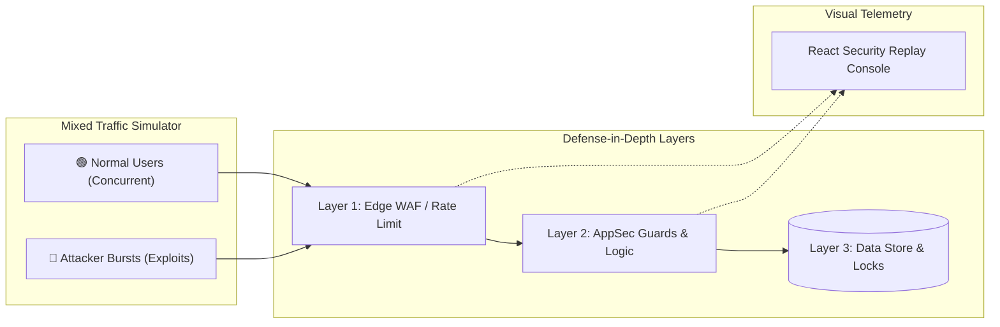

# 🛡️ PayGuard AppSec Lab

**End-to-End Application Security Engineering Lab**: Concurrent Mixed-Traffic Simulation (Normal Users + Unpredictable Attacker Bursts), Defense-in-Depth Verification (Edge WAF vs. Application Code), and SecDevOps CI Guardrails.

---

## 1. Architecture & Defense-in-Depth Pipeline

실제 서비스 환경에서는 다수의 일반 사용자 요청이 동시에 흐르는 가운데 공격자의 기습 페이로드가 불규칙하게 유입됩니다. 본 프로젝트는 **정상 트래픽의 가용성(Availability / False Positive 0%)**을 유지하면서 각 방어 계층(Edge WAF, AppSec Guard, Data Integrity Lock, CI SAST/DAST)이 공격을 어떻게 차단하는지 정량적으로 검증합니다.



---

## 2. Security Verification Matrix (Living Scoreboard)

각 시나리오는 **[취약점 재현(`v0.1`) ➔ Edge WAF 한계/오탐 검증(`v0.2`) ➔ 코드 레벨 근본 패치(`v0.3`) ➔ CI 재발 방지(`v0.4`)]** 순서로 검증 및 기록됩니다.

| # | Threat Scenario (OWASP) | `v0.1` Vulnerable | `v0.2` Edge WAF Only | `v0.3` Code Patched | `v0.4` CI Guardrail | Engineering Record |
| :-: | :--- | :--- | :--- | :--- | :--- | :--- |
| **1** | **BOLA / IDOR**<br>(`GET /api/orders/:id`) | 🔴 **100% Exploited**<br>(PII & Receipt Leaked) | 🟡 **0% Blocked**<br>(WAF Cannot Detect Context) | 🟢 **0% Exploited**<br>(Ownership Guard + 404) | ⏳ Pending | *In Progress (Module 1)* |
| **2** | **SQL Injection**<br>(Dynamic `ORDER BY`) | 🔴 Planned | ⏳ Planned | ⏳ Planned | ⏳ Planned | *Planned (Module 2)* |
| **3** | **XSS & Token Theft**<br>(Review DOM + JWT) | 🔴 Planned | ⏳ Planned | ⏳ Planned | ⏳ Planned | *Planned (Module 3)* |
| **4** | **Race Condition**<br>(Coupon Limit Overrun) | 🔴 Planned | ⏳ Planned | ⏳ Planned | ⏳ Planned | *Planned (Module 4)* |
| **5** | **Credential Stuffing**<br>(Login Burst) | 🔴 Planned | ⏳ Planned | ⏳ Planned | ⏳ Planned | *Planned (Module 5)* |

---

## 3. Quick Start (Local Sandbox & Replay Console)

```bash
# 1. Install dependencies
npm install

# 2. Start API (:4000) + React Security Replay Console (:5173)
npm run dev

# 3. Run CLI Mixed-Traffic & IDOR Benchmark
npm run test:idor
```
