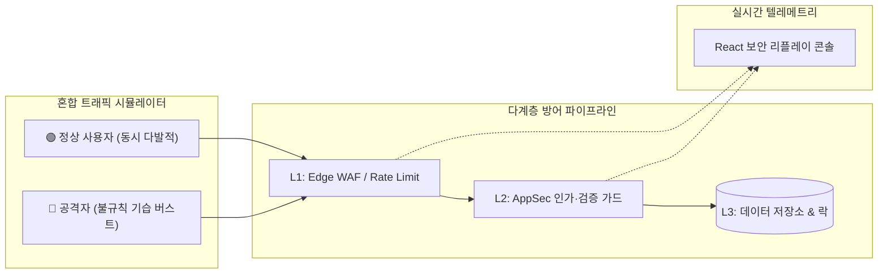

# 🛡️ PayGuard AppSec Lab

**혼합 트래픽 시뮬레이션 기반 애플리케이션 보안 엔지니어링 랩**: 동시 다발적 정상 사용자 트래픽 속에 기습 공격이 유입되는 환경을 재현하고, **다계층 방어(Edge WAF 한계/오탐 검증 → 코드 레벨 근본 패치 → SecDevOps CI 가드레일)** 효과를 정량적으로 검증합니다.

---

## 1. 아키텍처 및 방어 계층 (Defense-in-Depth)

실제 서비스에서는 다수의 정상 요청이 흐르는 가운데 공격자의 요청이 불규칙하게 섞여 들어옵니다. 본 프로젝트는 **정상 트래픽 가용성(오탐률 0%)**을 유지하면서 각 방어 계층이 공격을 어떻게 차단하는지 추적합니다.



---

## 2. 보안 검증 현황판 (지표 기준: 공격 성공률)

모든 단계(`v0.1 ~ v0.4`)는 동일한 지표인 **공격 성공률(Exploit Rate, 낮을수록 안전)**로 비교합니다.
각 시나리오는 **[취약 재현(`v0.1`) ➔ Edge WAF 단독(`v0.2`) ➔ 코드 패치(`v0.3`) ➔ CI 가드레일(`v0.4`)]** 순으로 Issue와 PR을 통해 검증·기록합니다.

| # | 취약점 시나리오 (OWASP) | `v0.1` 초기 취약 | `v0.2` Edge WAF 단독 | `v0.3` 코드 패치 | `v0.4` CI 가드레일 | 기록 (Issue / PR) |
| :-: | :--- | :--- | :--- | :--- | :--- | :--- |
| **1** | **BOLA / IDOR**<br>(`GET /api/orders/:id`) | 🔴 **공격 성공률 100%**<br>(타인 주문서·배송지 유출) | 🔴 **공격 성공률 100%**<br>(WAF 차단 0% · 문맥 판별 불가) | 🟢 **공격 성공률 0%**<br>(소유권 인가 Guard + 404) | ⏳ 진행 중<br>([Issue #2](https://github.com/KimseungMoo/payguard-appsec-lab/issues/2)) | [Issue #2](https://github.com/KimseungMoo/payguard-appsec-lab/issues/2) |
| **2** | **SQL Injection**<br>(동적 `ORDER BY`) | ⏳ 예정 | ⏳ 예정 | ⏳ 예정 | ⏳ 예정 | *Module 2 예정* |
| **3** | **XSS & 토큰 탈취**<br>(리뷰 DOM + JWT) | ⏳ 예정 | ⏳ 예정 | ⏳ 예정 | ⏳ 예정 | *Module 3 예정* |
| **4** | **Race Condition**<br>(선착순 쿠폰 중복 발급) | ⏳ 예정 | ⏳ 예정 | ⏳ 예정 | ⏳ 예정 | *Module 4 예정* |
| **5** | **Credential Stuffing**<br>(로그인 대량 대입) | ⏳ 예정 | ⏳ 예정 | ⏳ 예정 | ⏳ 예정 | *Module 5 예정* |

---

## 3. 빠른 실행 (로컬 샌드박스 & 리플레이 콘솔)

```bash
# 1. 의존성 설치
npm install

# 2. API 서버(:4000) + React 보안 리플레이 콘솔(:5173) 동시 실행
npm run dev

# 3. CLI 혼합 트래픽 & IDOR 벤치마크 실행
npm run test:idor
```
