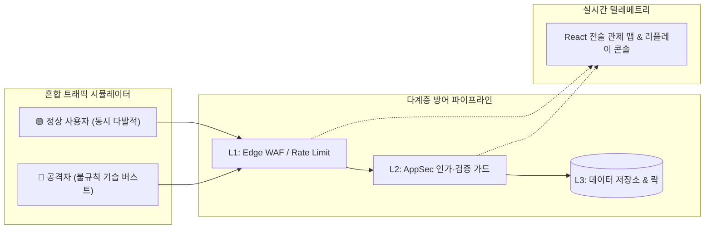

# 🛡️ PayGuard AppSec Lab

**실제 보안 사고 사례 기반 혼합 트래픽 시뮬레이션 & 다계층 방어(Defense-in-Depth) 검증 랩**

정상 사용자 요청이 동시 다발적으로 흐르는 커머스·결제 환경(`PayGuard`)에서 실제 보안 사고와 동일한 공격 패턴을 재현하고, **Edge WAF의 한계(`v0.2`) → 코드 레벨 근본 패치(`v0.3`) → CI 자동 회귀 차단(`v0.4`)** 과정을 실시간 관제 맵과 정량 지표로 검증합니다.

> 🌐 **설치 없이 바로 체험하는 라이브 콘솔 (GitHub Pages Static Replay)**: https://kimseungmoo.github.io/payguard-appsec-lab/
>
> *(시연 GIF 슬롯: 대시보드 `v0.1` 유출 → `v0.3` 차단 전환 12초 GIF 추가 예정)*

---

## 1. 아키텍처 및 방어 계층 (Defense-in-Depth)

실제 서비스에서는 다수의 정상 요청이 흐르는 가운데 공격자의 요청이 불규칙하게 섞여 들어옵니다. 본 프로젝트는 **정상 트래픽 가용성(오탐률 0%)**을 유지하면서 각 방어 계층이 공격을 어떻게 차단하는지 추적합니다.



---

## 2. 실제 보안 사고 × PayGuard 재현 시나리오

단순 교과서 예제가 아니라 **실제로 대규모 피해를 일으킨 보안 사고의 핵심 원인**을 커머스·결제 도메인 시나리오로 재구성했습니다.

| # | 실제 보안 사고 사례 (원인) | PayGuard 재현 시나리오 | 핵심 교훈 및 방어 대책 |
| :-: | :--- | :--- | :--- |
| **1** | **[USPS Informed Delivery (2018)](https://krebsonsecurity.com/2018/11/usps-site-exposed-data-on-60-million-users/)** · **[Peloton (2021)](https://www.infosecurity-magazine.com/news/peloton-apis-exposed-all-users/)**<br>로그인한 사용자가 API의 ID 값만 바꿔 수백만~6천만 명 개인정보 조회 | **BOLA / IDOR**<br>(`GET /api/orders/:id`) | 정상 HTTP 문법이라 **WAF 차단 0%**. 서버 코드에서 `order.userId === user.id` 소유권 인가 검증 및 `404` 은폐 필수 |
| **2** | **[TalkTalk (2015)](https://www.theguardian.com/business/2016/oct/05/talktalk-hit-with-record-400k-fine-over-cyber-attack)** · **[MOVEit Transfer (2023, CVE-2023-34362)](https://nvd.nist.gov/vuln/detail/CVE-2023-34362)**<br>동적 SQL 문자열 결합으로 수십만 명 정보·기업 파일 대량 유출 | **SQL Injection**<br>(동적 `ORDER BY` 정렬) | ORM 사용 중에도 바인딩 불가 구간(`ORDER BY`)에서 발생. WAF 오탐을 피하고 **허용 컬럼 화이트리스트 매핑** 적용 |
| **3** | **[TweetDeck XSS 웜 (2014)](https://www.kaspersky.com/blog/serious_vulnerability_tweetdeck/5076/)** · **[British Airways Magecart (2018)](https://en.wikipedia.org/wiki/British_Airways_data_breach)**<br>악성 스크립트 삽입·실행으로 자동 전파 및 수십만 건 카드 정보 탈취 | **XSS & 토큰 탈취**<br>(리뷰 DOM + 인증 토큰) | `DOMPurify` 살균 + 세션 토큰 `HttpOnly; SameSite` 쿠키 전환 + 엄격한 **CSP** 적용 |
| **4** | **[Starbucks 기프트카드 이중 사용 (2015)](https://www.siliconrepublic.com/enterprise/starbucks-gift-card-hack-found-giving-unlimited-funds)**<br>동시 요청 경합(TOCTOU)을 이용해 잔액 이상의 금액을 중복 이체·결제 | **Race Condition**<br>(선착순 쿠폰 중복 발급) | 단순 IP Rate Limit은 공용망 오탐 유발. **DB 원자적 조건 업데이트**와 **멱등키(Idempotency Key)**로 해결 |
| **5** | **[DraftKings 계정 탈취 (2022)](https://www.bleepingcomputer.com/news/security/18-year-old-charged-with-hacking-60-000-draftkings-betting-accounts/)**<br>유출된 타 사이트 계정 목록을 봇으로 대입해 약 6만 개 계정 탈취·출금 시도 | **Credential Stuffing**<br>(로그인 대량 대입) | **계정 + IP 이중 Sliding Window Rate Limit** 및 이상 시도 탐지로 정상 로그인 가용성 보호 |

---

## 3. 단일 서비스 단계별 보안 진화 현황판 (`PayGuard` 누적 하드닝)

본 프로젝트는 개별 취약점 예제 5개를 따로 만드는 대신, **하나의 `PayGuard` 커머스 서비스가 Module 1부터 Module 5까지 단계적으로 보안 강화(Progressive Hardening)되는 과정**을 추적합니다.
모든 단계(`v0.1 ~ v0.4`)는 동일한 지표인 **공격 성공률(Exploit Rate, 낮을수록 안전)**로 비교하며, 각 모듈은 **[취약 재현(`v0.1`) ➔ Edge WAF 단독(`v0.2`) ➔ 코드 패치(`v0.3`) ➔ CI 가드레일(`v0.4`)]** 순으로 Issue와 PR을 통해 누적 잠금됩니다.

| # | 취약점 시나리오 (OWASP) | `v0.1` 초기 취약 | `v0.2` Edge WAF 단독 | `v0.3` 코드 패치 | `v0.4` CI 가드레일 | 기록 (Issue / PR) |
| :-: | :--- | :--- | :--- | :--- | :--- | :--- |
| **1** | **BOLA / IDOR**<br>(`GET /api/orders/:id`) | 🔴 **공격 성공률 100%**<br>(타인 주문서·배송지 유출) | 🔴 **공격 성공률 100%**<br>(WAF 차단 0% · 문맥 판별 불가) | 🟢 **공격 성공률 0%**<br>(소유권 인가 Guard + 404) | 🟢 **검증 완료**<br>(CI 게이트 + Pages 배포) | [Issue #2](https://github.com/KimseungMoo/payguard-appsec-lab/issues/2) · [PR #3](https://github.com/KimseungMoo/payguard-appsec-lab/pull/3) · [PR #4](https://github.com/KimseungMoo/payguard-appsec-lab/pull/4) |
| **2** | **SQL Injection**<br>(동적 `ORDER BY`) | ⏳ 예정 | ⏳ 예정 | ⏳ 예정 | ⏳ 예정 | *Module 2 예정* |
| **3** | **XSS & 토큰 탈취**<br>(리뷰 DOM + JWT) | ⏳ 예정 | ⏳ 예정 | ⏳ 예정 | ⏳ 예정 | *Module 3 예정* |
| **4** | **Race Condition**<br>(선착순 쿠폰 중복 발급) | ⏳ 예정 | ⏳ 예정 | ⏳ 예정 | ⏳ 예정 | *Module 4 예정* |
| **5** | **Credential Stuffing**<br>(로그인 대량 대입) | ⏳ 예정 | ⏳ 예정 | ⏳ 예정 | ⏳ 예정 | *Module 5 예정* |

---

## 4. 빠른 실행 (로컬 샌드박스 & 리플레이 콘솔)

- **라이브 정적 리플레이 콘솔 (GitHub Pages)**: https://kimseungmoo.github.io/payguard-appsec-lab/

```bash
# 1. 의존성 설치
npm install

# 2. API 서버(:4000) + React 보안 리플레이 콘솔(:5173) 동시 실행
npm run dev

# 3. CLI 혼합 트래픽 & IDOR 벤치마크 실행
npm run test:idor

# 4. CI 회귀 게이트 검증 (v0.3-patched 상태 필수)
npm run test:idor:ci
```
